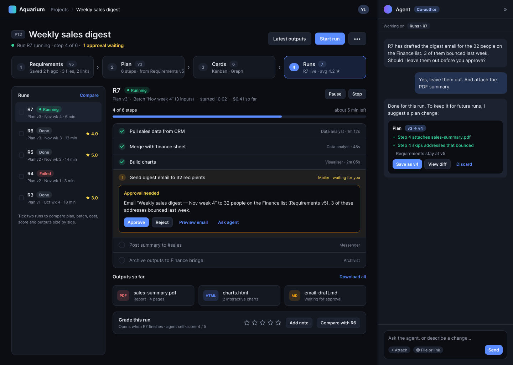
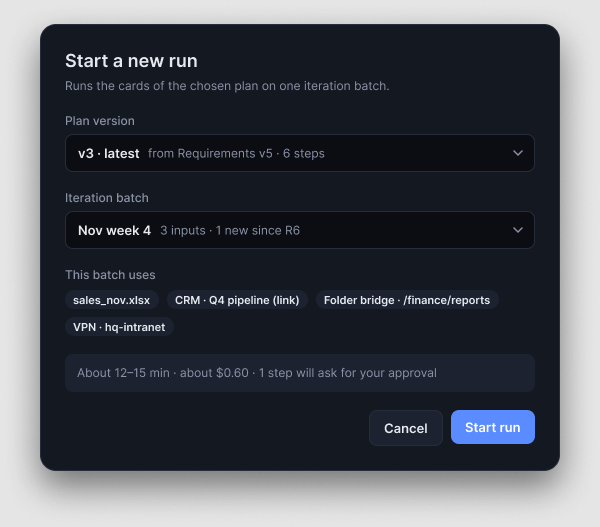

# Projects detail page — "less is more" redesign

Status: **design approved by Yan (2026-11-27), not yet implemented.** This folder is the
handoff for the agent that builds it in `agent-home/` (the primary UI — see `AGENTS.md`).

- Figma (source of truth for layout and tokens): <https://www.figma.com/design/2ulo0wiREINRTTsynkpkgl>
  (file "Aquarium — Projects detail redesign", page "Projects detail"; frames
  `Project detail — Runs step (key mockup)` and `Start run dialog`).
- Screenshots: [`screenshots/runs-step-desktop.png`](screenshots/runs-step-desktop.png),
  [`screenshots/start-run-dialog.png`](screenshots/start-run-dialog.png).
- Exact values without Figma access:
  - [`figma-spec.json`](figma-spec.json): every layer's size, auto-layout (gap/padding/alignment),
    fill/stroke colour, radius, text and font, exported from the Figma file. Treat it as the pixel
    spec; map hex values to the theme tokens in section 4, not hard-coded colours.
  - [`figma-build-script.js`](figma-build-script.js): the Figma Plugin API script that drew the
    mockup. Run it through the Figma MCP `use_figma` tool on a blank file to rebuild or extend it.
- With Figma MCP access, `get_design_context` / `get_screenshot` on file `2ulo0wiREINRTTsynkpkgl`
  (nodes `1:2`, `1:277`) return the same details. Extend the file (Requirements and Cards steps)
  rather than starting a new one.

## 1. Requested workflow (owner's words)

> Projects:
> - requirements (text, files, links, VPN or folder bridge references) (versioned) (save button will auto increment the version number) -> Plan (versioned) (Plan can be auto generated or manually updated) -> Cards (kanban & Graph) (card contents can also be auto generated or manually updated) -> Iteration batch -> Run (Inputs & Outputs);
> - Major interactions: 1) edit requirements, plan & cards either directly or co-create with an agent. Files or links (internal or external) are part of the requirements; 2) Start a new run (can select different iteration batch) with a specific version of the plan; 3) Monitor a run and interact with its associated actions such as approval; 4) Get the output of the run; 5) Review, grade and compare results after run;

## 2. What exists today (develop `867581abf`) and why it's hard

Route `agent-home/src/app/projects/[slug]/page.tsx` → `components/projects/ProjectDetailView.tsx`.

- **Header** stacks: ref badge + name, category tag, `ProjectLifecycleMenu`, `ProjectUsageLine`,
  AI summary, `ReadinessChecklist`, `JourneyBar`, `LiveStatusBar`, `ProjectHealth`.
- **Navigation**: `ProjectTabsNav` (Planning | Execution | Log) plus a second row
  `ProjectPartsNav` (`tabs/sections.ts`): Planning = Scope · Inputs · Plan · Outputs;
  Execution = Runs · Dashboard · Board · Iterations. "More" sheet = Skills, Settings. Phone adds a
  Chat tab; desktop has the docked `ProjectChatPanel`.
- **Sheets**: `AddToProjectSheet`, `SummariseSheet`, `ChangeRequestSheet` (plan diff), `EditBriefSheet`.
- **Sub-pages**: `/projects/[slug]/cards/[id]` (`CardDetailView`: approvals, worker log, rerun) and
  `/projects/[slug]/runs/[runNo]` (`RunView`).

Problems:
- About 13 destinations (tabs × sub-tabs, sheet parts, chat, 4 sheets, 2 sub-pages).
- Requirements are split across Scope and Inputs; Outputs sit under Planning although runs produce them.
- Runs, Dashboard, Board and Iterations all answer "how is the work going".
- Six status widgets in the header.
- Version lineage (requirements vN → plan vM → run) is not visible.
- Approvals and grading are buried in card/run pages; runs can't be compared.

## 3. Principles

1. **One spine, four steps**: Requirements → Plan → Cards → Runs. That is the navigation; nothing else is a tab.
2. **One primary action at a time** (e.g. "Approve 1 step", "Start run", "Regenerate plan").
3. **Edit in place; Save = new version.** No edit sheets. Every Save makes vN+1; history/diff from the version pill.
4. **The agent is a co-author, not a page.** One right-hand panel that knows the current step; it
   proposes changes as a diff; "Save as vN+1" accepts, "Discard" drops it.
5. **Status is one sentence**, e.g. "Run R7 running · step 4 of 6 · 1 approval waiting".
6. **Hide the rare**: Log, Skills, Settings, usage, lifecycle go into the ⋯ menu.

## 4. Layout (desktop, 1440 wide)

- **Top bar** (existing `MobileShell`), breadcrumb `Projects / <name>`.
- **Header**: ref + name, status sentence, buttons `Latest outputs`, `Start run` (primary), `⋯`.
- **Spine**: 4 equal step cards, number + name + version/count pill + one muted line:
  `Requirements v5 · Saved 2 h ago · 3 files, 2 links` › `Plan v3 · 6 steps · from Requirements v5` ›
  `Cards 6 · Kanban · Graph` › `Runs 7 · R7 live · avg 4.2 ★`. Selected step: accent border.
  A step shows a warning dot when it is behind its parent (plan built from Requirements v4 while requirements are v5).
- **Workspace**: the selected step, full width of the main column.
- **Agent panel**: 380 px, right, collapsible (`»`), same collapse pattern as the chat page
  (PR #1089). Header "Agent · Co-author", context chip "Working on: Runs › R7", messages,
  proposal cards, composer with `+ Attach`, `@ File or link`, `Send`.
- **Needs-you banner**: only on steps other than Runs, when something waits on the user; one click acts on it.
- Phone: spine becomes a horizontal scroller of 4 chips; agent panel becomes the existing Chat tab.

Theme: existing `agent-home/src/app/globals.css` tokens only (`--color-bg #0b0d12`,
`--color-surface #141821`, `--color-surface-2 #1c2230`, `--color-border #262d3a`,
`--color-accent #5b8cff`, `--color-warn #f59e0b`/`--color-warn-text #fcd34d`,
`--color-success #34d399`, `--color-danger #f87171`; radii 8/10/12), Inter.

## 5. The four steps

| Step | Shows | Actions |
|---|---|---|
| **Requirements** | One document: text with files, links (internal/external), VPN and folder-bridge references as inline chips | Edit · Attach · Ask agent · Save (→ v+1) · History/compare |
| **Plan** | Ordered steps; "Built from Requirements vN" | Generate from requirements · Edit · Ask agent · Save (→ v+1) · History/diff |
| **Cards** | Kanban ⇄ Graph toggle over the same cards | Generate from plan · Edit card · Ask agent |
| **Runs** | Run list (left, 264 px) + selected run (right) | Start run · Pause/Stop · Approve/Reject · Open/download outputs · Grade · Compare |

### Runs step (key mockup)
- **Run list**: rows `R7 [Running] Plan v3 · Nov wk 4 · 6 min`, done runs show `★ 4.0`; a tick box
  per row; header link `Compare`; hint "Tick two runs to compare plan, batch, cost, score and outputs side by side."
- **Selected run**: `R7 [Running]`, meta `Plan v3 · Batch "Nov week 4" (3 inputs) · started 10:02 · $0.41 so far`,
  `Pause`, `Stop`; progress "4 of 6 steps · about 5 min left"; one row per card (done ✓ / waiting ! / todo ○,
  profile + duration on the right).
- **Inline approval** under the waiting card: "Approval needed", plain-language description,
  `Approve` (primary), `Reject`, `Preview email`, `Ask agent`.
- **Outputs so far**: tiles (type badge, name, one-line description), `Download all`.
- **Grade this run**: 5 stars + `Add note` + `Compare with R<previous>`; shows the agent self-score
  ("agent self-score 4 / 5"). Opens when the run finishes.

### Start run dialog
Title "Start a new run", sub "Runs the cards of the chosen plan on one iteration batch."
Fields: **Plan version** (default latest, meta "from Requirements v5 · 6 steps"), **Iteration batch**
(meta "3 inputs · 1 new since R6"), "This batch uses" chips (files, links, folder bridge, VPN),
estimate line (time, cost, number of approval steps), `Cancel` / `Start run`.

## 6. The five interactions

1. **Edit / co-create**: open a step and type, or ask the agent; the agent returns a diff; accepting saves a new version.
2. **Start a run**: the dialog above; nothing else is asked.
3. **Monitor**: per-card progress and inline approvals; the header sentence mirrors it (live via the existing SSE).
4. **Outputs**: appear in the run as produced; latest run's outputs one click from the header.
5. **Review / grade / compare**: stars + note per run, agent self-score beside it; tick two runs → side-by-side.

## 7. What goes away
Planning/Execution/Log tabs and `ProjectPartsNav`; Dashboard and Iterations as separate views
(folded into Runs); `EditBriefSheet` / `ChangeRequestSheet` as entry points (edit in place + agent
diff; their logic can be reused); the stacked header widgets (replaced by the status sentence).
Keep `?tab=` deep links working by mapping old values in `resolveTabParam` to the 4 steps.

## 8. Implementation notes for the next agent

Map to existing code before building anything new (extend, don't duplicate):

| Design piece | Start from |
|---|---|
| Spine + step state | `tabs/sections.ts` (`resolveTabParam`), `ProjectTabsNav`, `dashboard/journey.ts` / `JourneyBar` |
| Status sentence | `live/liveState.ts` (`LiveStatusBar`), `dashboard/nextAction.ts`, `ProjectNextStep.ts` |
| Requirements doc | `tabs/ScopeTab.tsx`, `tabs/InputsTab.tsx`, `inputs/*` (FileDropZone, LinkNoteInput, MemoryPicker), `EditBriefSheet.tsx`, `iterations/RequirementHistory.tsx` |
| Plan + versions/diff | `tabs/PlanTab.tsx`, `PlanDraft`, `PlaybookVersioning.tsx`, `changes/PlanDiffView.tsx`, `changes/planDiff.ts` (`PlaybookRev`) |
| Cards Kanban/Graph | `board/BoardView.tsx`, `cards/PlaybookCards.tsx`, `cards/stepCards.ts`, `CardEditor.tsx` |
| Runs list/detail | `execution/ExecutionRuns.tsx`, `RunView.tsx`, `execution/runStats.ts`, `iterations/groupIterations.ts` |
| Inline approvals | `CardApprovals.tsx`, `board/NeedsYouStrip.tsx`, `ProjectRun.waiting_on_you` |
| Outputs | `outputs/*` (`LatestOutputsShelf`, `DeliverableCard`, `useProjectArtifacts`) |
| Grade | `ProjectRun.score_user` / `score_self` / `score_note`; `ProjectDetail.score` |
| Agent panel | `chat/ProjectChatPanel.tsx`, `chat/ProjectChatDock.tsx`, `chat/dockState.ts`, `chat/ProposedPlaybookCard` |

Data gaps to verify (not confirmed while designing):
- **Requirements version number**: the brief has change history (`ProjectChangesHistory`) but no
  visible `vN`; check whether a revision counter exists or needs an additive column.
- **Iteration batch as a selectable entity**: today "iterations" are derived groupings
  (`groupIterations.ts`); runs record `playbook_rev` but no batch id. Starting a run "with a
  batch" may need an additive field and API parameter.
- **Plan → requirements lineage** ("from Requirements v5") needs the requirements version stored on each playbook revision.
- **Graph view of cards**: confirm what exists in `cards/`; may be new.
- **Run compare** view: new; reuse `runStats.ts`.
- **Run start with chosen plan version**: confirm the start-run API accepts a playbook revision.

Suggested order: (1) spine + 4-step routing with old deep links mapped, header sentence;
(2) Runs step (list, detail, inline approval, outputs, grade); (3) Start run dialog;
(4) Requirements editor with Save → vN+1; (5) Plan with versions/diff; (6) Cards Kanban/Graph;
(7) agent panel context + proposal cards; (8) compare view. Each is a separate PR; mock up
Requirements and Cards (Graph) in the same Figma file first and get Yan's approval.
Run `npx tsc -p . --noEmit`, `npm run lint`, `npx vitest run` in `agent-home/`, and add new routes
to `scripts/smoke/agent_home_smoke.py`.
